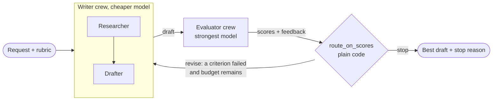
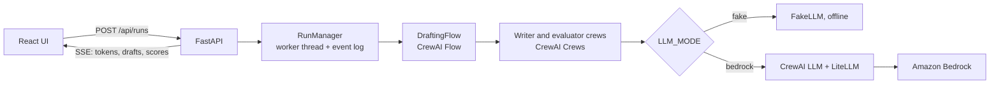
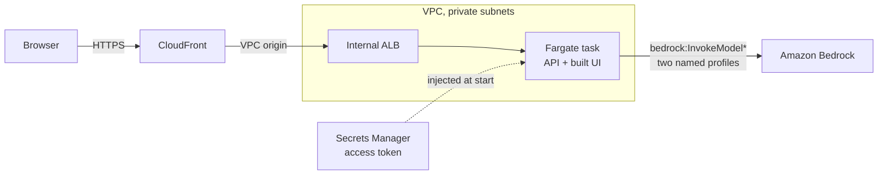

# poc-crewai-evaluator

A proof of concept showing one agent framework, [CrewAI](https://docs.crewai.com), implementing one
agentic pattern, the **evaluator-optimizer** loop, for one enterprise job: drafting policy and
compliance documents.

Ask for "an acceptable-use policy for AI tools for a 500-person fintech" and pick a rubric. A writer
crew drafts the policy, an evaluator scores it against each rubric criterion and says what to fix,
and the draft goes round again until every criterion passes or the iteration budget runs out. You
can watch each iteration stream live, compare drafts side by side, follow the scores and export the
result as Markdown.

No AWS account is needed to try it:

```bash
make dev     # then open http://localhost:5173
```

You need [uv](https://docs.astral.sh/uv/) and Node.js 24 (see `.nvmrc`). This runs an offline fake
LLM by default.

> **Status:** everything here runs offline and in CI. It has not been run against real Bedrock or
> deployed to a real AWS account, because neither was available when it was built. See
> [Limitations](#limitations-and-next-steps).

## The pattern

In an **evaluator-optimizer** loop, one agent produces work and another judges it against explicit
criteria. The judgement goes back to the producer as feedback, and the cycle repeats until the work
passes or a limit is reached. It is the difference between asking for a draft once and having it go
through review.

**Use it when:**

- You can write down what "good" means, and a reviewer could apply those criteria consistently.
- Specific feedback would really improve the next attempt, as it would with a human writer.
- The extra cost and latency are worth it, because a weak result is expensive. A policy that misses
  an obligation is a good example.

**Avoid it when:**

- A single pass is already good enough. You would pay several times over for nothing.
- The criteria are vague. The loop will then converge on the evaluator's taste, not on quality.
- A deterministic check can decide. Use a schema, a linter or a test instead of a model.
- You need an answer quickly, or within a tight budget per request.
- The evaluator is no better placed to judge than the writer. Two models that share a blind spot
  will agree confidently.

The loop does not replace human review. Treat a pass as "ready for a person to read" rather than
"approved". The exported file says so in its front matter.

## Architecture

### The loop



### The running system



### In AWS



## How CrewAI expresses the pattern

CrewAI has two abstractions, and they map neatly onto the two halves of the pattern.

| Pattern | CrewAI | Here |
| --- | --- | --- |
| Control loop, exit condition | **Flow** with `@start`, `@listen`, `@router` | [`flow.py`](src/policy_drafter/flow.py) |
| Loop state | Typed Flow state | `DraftingState` in [`models.py`](src/policy_drafter/models.py) |
| Optimizer | **Crew**, sequential process | `build_writer_crew` in [`crews.py`](src/policy_drafter/crews.py) |
| Evaluator | **Crew** with one agent | `build_evaluator_crew` in [`crews.py`](src/policy_drafter/crews.py) |
| Model tiers | Per-agent `LLM` | [`llm.py`](src/policy_drafter/llm.py) |
| Progress stream | Event bus (`LLMStreamChunkEvent`) | [`streaming.py`](src/policy_drafter/streaming.py) |

The loop itself is a few decorated methods. A router label feeds back into an earlier step:

```python
class DraftingFlow(Flow[DraftingState]):
    @start()
    def begin(self) -> None: ...

    @listen(or_(begin, "revise"))  # first draft, or a revision
    def write_draft(self) -> None: ...

    @listen(write_draft)
    def evaluate_draft(self) -> None: ...

    @router(evaluate_draft)  # no model decides this, only code
    def route_on_scores(self) -> Literal["revise", "stop"]: ...

    @listen("stop")
    def finish(self) -> None: ...
```

Start with [`flow.py`](src/policy_drafter/flow.py), then
[`prompts.py`](src/policy_drafter/prompts.py) to see how feedback reaches the drafter.

### Design decisions

- **Code decides when to stop, not a model.** `route_on_scores` compares scores with pass marks. The
  stop reason is always recorded: `passed`, `max_iterations`, `evaluator_error` or `error`.
- **Spend on judgement.** The evaluator gets `BEDROCK_MODEL_ID` (Opus 5.5 by default), because a weak
  evaluator makes the whole loop pointless. The researcher and drafter write the most text, so they
  get the cheaper `BEDROCK_WORKER_MODEL_ID` (Sonnet 5.5 by default).
- **An independent evaluator.** It sees only the current draft and the rubric, never the pass mark or
  earlier iterations, so neither can anchor its scores.
- **Malformed scores fail closed.** [`scoring.py`](src/policy_drafter/scoring.py) recovers what it can
  from fenced, truncated or oddly shaped JSON, and never raises. A criterion with no usable score
  does not pass. If nothing can be parsed, the evaluator is asked once more and then the run stops
  with `evaluator_error`, rather than revising blindly.
- **The best draft wins, not the last.** At the iteration limit, revisions may have made things worse,
  so the result is the draft with the most criteria passed, then the highest mean score.
- **Bounded by construction.** `max_iterations` is validated against a hard limit of 8, and concurrent
  runs are capped because each one costs money.
- **Prompts are rendered in Python.** CrewAI's `kickoff(inputs=...)` substitutes placeholders one after
  another, so a `{feedback}` inside a user's request would be replaced. A test covers this.

### Rubrics

Rubrics are YAML files in [`rubric_files/`](src/policy_drafter/rubric_files/), so a compliance team
can change the quality bar without touching code. Four are bundled: completeness, regulatory coverage,
clarity and tone. Scores run from 0 to 10.

```yaml
id: regulatory_coverage
name: Regulatory coverage
description: Does the policy address the obligations that apply to this organisation?
threshold: 7            # the default pass mark
criteria:
  - id: citation_accuracy
    name: Citation accuracy
    description: Citations are specific and plausible. Anything uncertain is flagged for legal review.
    threshold: 8        # overrides the default
```

## Run it locally

### With the fake LLM

```bash
make dev     # API on :8000, UI on http://localhost:5173
make check   # lint, type checks, tests, build and cdk synth, all offline
```

The fake LLM is not a canned reply. Its drafter writes a section for each item of feedback in its
prompt, and its evaluator raises a score only when the draft contains that section, so the demo
converges only if feedback really travels through the loop.

- To see the iteration limit, set **Max iterations** to 1 or 2 with the Regulatory coverage rubric.
- To see a run never pass, set **Pass mark override** to 10. The fake evaluator never scores above 9.5.

### With real Bedrock

You need AWS credentials, plus [model access](#before-the-first-deploy), in the Region you use.

```bash
export AWS_PROFILE=your-profile
LLM_MODE=bedrock AWS_REGION=us-east-1 make dev
```

| Variable | Default | Meaning |
| --- | --- | --- |
| `LLM_MODE` | `fake` | `fake` or `bedrock` |
| `BEDROCK_MODEL_ID` | `us.anthropic.claude-opus-5-5` | Evaluator |
| `BEDROCK_WORKER_MODEL_ID` | `us.anthropic.claude-sonnet-5-5` | Researcher and drafter |
| `AWS_REGION` | `us-east-1` | Must be a source Region for the profile's geography |
| `API_ACCESS_TOKEN` | unset | When set, the API requires this bearer token |
| `MAX_CONCURRENT_RUNS` | `2` | Further runs get a 429 |

The defaults are cross-Region inference profile ids from the
[Bedrock model cards](https://docs.aws.amazon.com/bedrock/latest/userguide/model-cards.html). Outside
the US, change the prefix, for example to `eu.anthropic.claude-opus-5-5`.
`us.anthropic.claude-haiku-5-5` is a cheaper option for the worker tier.

### Without the UI

```bash
uv run policy-drafter "Draft a data retention policy for a hospital" \
  --rubric completeness --max-iterations 3 --output policy.md
```

The exit code is 0 only if every criterion passed.

## Deploy

The infrastructure is [AWS CDK in TypeScript](infra/). I chose TypeScript because the UI already
needs Node, so the project adds no extra toolchain, and because the CDK's own examples and types are
strongest there. `cdk synth` and the stack's tests run in CI with no AWS credentials.

**This has never been deployed.** Treat the first deployment as a test, in a non-production account.

### Before the first deploy

1. Install Docker, which builds the image during deployment, and get credentials that can deploy CDK
   stacks.
2. Submit Anthropic's
   [first-time use form](https://docs.aws.amazon.com/bedrock/latest/userguide/model-access.html) once
   per account or organization, from the Bedrock console.
3. Invoke each model once, as an identity with the `aws-marketplace` permissions. That completes the
   subscription, and the running service deliberately does not have those permissions:

   ```bash
   for model in us.anthropic.claude-opus-5-5 us.anthropic.claude-sonnet-5-5; do
     aws bedrock-runtime converse --region us-east-1 --model-id "$model" \
       --messages '[{"role":"user","content":[{"text":"Hello"}]}]'
   done
   ```

4. Bootstrap the account and Region once: `npm --prefix infra run cdk -- bootstrap`.

### Deploy and sign in

```bash
make deploy
```

`make deploy` runs `cdk deploy`, which asks you to approve the IAM changes. The outputs include
`AppUrl` and `AccessTokenSecretName`. Read the access token with:

```bash
aws secretsmanager get-secret-value --secret-id <AccessTokenSecretName> \
  --query SecretString --output text
```

Open `AppUrl` and paste the token into the form. To remove everything, run
`npm --prefix infra run cdk -- destroy`. The NAT gateway, load balancer and Fargate task cost money
while they exist, even when idle.

### What gets created

- **CloudFront, then a VPC origin, then an internal ALB, then one Fargate task.** CloudFront provides
  HTTPS without a domain, and nothing in the VPC is reachable from the internet.
- **IAM scoped to the model ids.** `bedrock:InvokeModel*` on the two named inference profiles, and on
  their foundation models in each destination Region, only when reached through those profiles. Tests
  in [`stack.test.ts`](infra/test/stack.test.ts) enforce this.
- **The access token in Secrets Manager.** It is generated at deploy time and injected by ECS, so it
  never appears in the template or a plain environment variable.

### Other Regions

Outside `us-east-1`, `us-east-2` and `us-west-2`, or with non-US profiles, list where your profiles
route. Routing depends on the source Region:

```bash
aws bedrock get-inference-profile --region eu-west-1 \
  --inference-profile-identifier eu.anthropic.claude-opus-5-5 --query 'models[].modelArn'

AWS_REGION=eu-west-1 npm --prefix infra run cdk -- deploy \
  -c modelId=eu.anthropic.claude-opus-5-5 -c workerModelId=eu.anthropic.claude-sonnet-5-5 \
  -c bedrockDestinationRegions=eu-central-1,eu-north-1,eu-south-1,eu-south-2,eu-west-1,eu-west-3
```

CloudFront VPC origins are not available in
[every Availability Zone](https://docs.aws.amazon.com/AmazonCloudFront/latest/DeveloperGuide/private-content-vpc-origins.html#vpc-origins-supported-regions),
such as `use1-az3` in `us-east-1`. If the VPC origin fails to create, this is the first thing to check.

## Testing

Everything runs offline. The Python tests use real CrewAI Flows and Crews against scripted LLMs,
without mocking the framework.

| What | Where |
| --- | --- |
| Terminates on pass and at max iterations | [`tests/test_flow.py`](tests/test_flow.py) |
| Feedback reaches the drafter's prompt | [`tests/test_flow.py`](tests/test_flow.py) |
| Rubric parsing | [`tests/test_rubrics.py`](tests/test_rubrics.py) |
| Score parsing against malformed output | [`tests/test_scoring.py`](tests/test_scoring.py) |
| The real CrewAI, LiteLLM and botocore path against a local Bedrock stub | [`tests/test_bedrock_wire.py`](tests/test_bedrock_wire.py) |
| API, SSE resume, limits and access token | [`tests/test_api.py`](tests/test_api.py) |
| UI components, event reducer, diff and export | [`web/src/`](web/src/) (Vitest) |
| IAM scope, network path and CloudFront streaming settings | [`infra/test/`](infra/test/) (Vitest) |

## Limitations and next steps

**Not yet proven**

- It has never called real Bedrock. The wire test checks the request URL, signing region and body, and
  parses a stubbed streaming reply, but a stub cannot show how the models actually behave. Prompts and
  scoring anchors will need tuning against real output.
- It has never been deployed. The stack synthesizes and its properties are tested, but SSE through
  CloudFront and the VPC origin in particular need checking on a first deployment.

**Quality of the output**

- The researcher has no internet access or tools, so its knowledge of regulations may be out of date
  or wrong. It is told to mark uncertain claims with `[VERIFY]`, which reduces the risk of invented
  citations but cannot eliminate it. A retrieval tool over real regulatory sources is the most
  valuable next step.
- Evaluator and writer can share blind spots. A pass is a reason to send a draft for review, not a
  substitute for legal review.
- The loop does not detect a stall. It keeps revising until the budget runs out even if scores stop
  improving.
- A draft truncated at the 16,000 output token limit is not detected.

**Running it for real**

- Runs live in memory on a single task, so a restart or deployment loses them. Persisting the event
  log would allow more than one task.
- Runs cannot be cancelled, and closing the browser does not stop one. The iteration limit bounds the
  cost, but there is no token or spend budget.
- One shared access token protects the API. There are no per-user identities, audit trail or rate
  limits beyond the concurrency cap.
- The request text goes straight into the prompts, so a malicious request could try to steer the
  agents. Drafts are displayed as plain text and never rendered as HTML.
- CrewAI's dependencies make for a large install: about 1 GB in `.venv` and a 1.1 GB image.

## Known limitations / hardening

Found in review and deliberately left for later; none changes the result on normal input.

- **Score parsing is best-effort.** Unscored or ambiguous criteria fail closed, but a model that answers on another scale (0-1, 1-5) is read at face value and costs revisions.
- **Adversarial evaluator replies** (thousands of nested brackets, many fences) can make parsing slow; repair input is capped, strict decodes are not.
- **Fence stripping is a heuristic.** An untagged fence around a draft that is itself one code block, or fences of unequal length, are not told apart.
- **`mean_score` counts an unscored criterion as 0**, which only matters when breaking ties between drafts.
- **Evaluator retry has no backoff** and retries any exception, not just transient ones.
- **A failed or empty draft ends the run**, keeping the best evaluated draft, instead of retrying the drafter.
- **Prompt injection is mitigated, not solved.** Request, draft and feedback text cannot close the tags that frame them, but researcher notes reach the drafter unframed and a model can still be talked into following instructions inside user text. Treat the output as a draft for human review.
- **Token streaming** relies on CrewAI dispatching events with the caller's context; it is tested against CrewAI 1.15.x only, and tokens are dropped silently if that changes.
- **API/UI:** shutdown ends open event streams without a terminal event and does not stop in-flight workers; a client that reconnects mid-phase misses the live tokens already sent; an invalid `Last-Event-ID` header returns 422 rather than replaying from the start; the UI has no retry if the API is down at page load, and a malformed event payload shows as a dropped connection.
- **Auth:** with `LLM_MODE=bedrock` and no `API_ACCESS_TOKEN` the API only logs a warning. Always set a token when the API is reachable from a network.
- **Evaluator retry** keeps the first reading when both score the same number of criteria, even if the retry was stricter.
- **Infra is never deployed.** `cdk synth` and the stack tests pass, but behaviours that need a real account are unverified: the CloudFront-to-ALB path through the managed prefix list (about 55 security-group rules, close to the default quota), and first-start timing. `GEOGRAPHIC_PROFILE` accepts `us|eu|au|jp|ca` inference-profile prefixes only, so `apac.`, `global.` and `us-gov.` profiles are rejected at synth time.
- **Graceful shutdown** waits for in-flight runs; ECS sends SIGKILL after its stop timeout.
- **A shared access token** is the only authentication. There is no per-user identity, quota or audit trail.

## Licence

[MIT](LICENSE)
